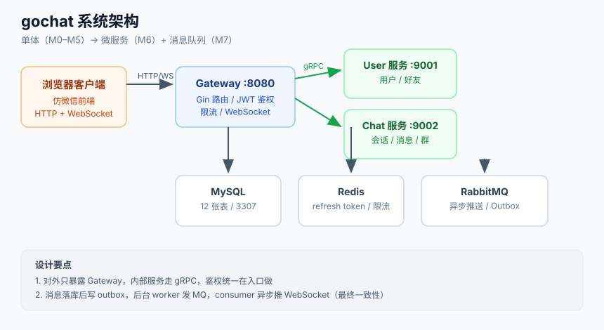

# gochat · 仿微信 IM 后端 + 演示前端 + 学习博客

一个用 Go 从零实现的即时通讯后端（单聊 / 群聊 / WebSocket 实时消息 / WebRTC 语音通话），
并完整走过了 **单体 → gRPC 微服务 → RabbitMQ 最终一致性** 的演进过程。
仓库内附带一个**仿微信的三栏演示前端**和一个 **Hexo 学习博客**。



---

## 一、快速开始

### 1. 启动依赖（Docker）

```bash
# 项目根目录（有 docker-compose.yml）
docker compose up -d
# MySQL: 127.0.0.1:3307  Redis: 6379  RabbitMQ: 5672（管理台 15672）
```

### 2. 启动后端（同时托管前端和博客）

```bash
go run . -db
# -db 参数会执行 AutoMigrate 建表
```

启动后：

| 地址 | 内容 |
|---|---|
| http://127.0.0.1:8080/ | **仿微信前端演示** |
| http://127.0.0.1:8080/blog/ | **项目学习博客**（Hexo） |
| http://127.0.0.1:8080/health | 健康检查 |
| :9001 / :9002 | gRPC 用户服务 / 聊天服务 |

### 3. 生成演示数据（推荐）

另开一个终端：

```powershell
powershell -ExecutionPolicy Bypass -File .\scripts\seed-demo.ps1
```

会创建 `alice / bob / carol`（密码都是 `123456`）、好友关系、单聊消息、三人群聊。

### 4. 体验

1. 浏览器打开 http://127.0.0.1:8080/ 登录 `alice / 123456`
2. 另开一个**无痕窗口**登录 `bob / 123456`
3. 两个窗口互发消息（WebSocket 实时推送）
4. 单聊顶部点 📞 发起 **WebRTC 语音通话**（localhost 是安全上下文，允许麦克风）
5. 通讯录里加好友、建群、拉人、踢人、拉黑

> 语音通话：同一台机器开两个窗口即可体验 P2P 直连（无需 STUN/TURN）。
> 跨机器/跨网演示需要在 `web/js/webrtc.js` 里配置 STUN/TURN。

---

## 二、技术栈

| 层 | 技术 |
|---|---|
| Web 框架 | Gin |
| ORM | GORM + MySQL 8 |
| 缓存 | Redis |
| 鉴权 | JWT 双 token（access + refresh，无感刷新） |
| 实时通信 | gorilla/websocket |
| 语音 | WebRTC（信令服务，服务端只转发 SDP/ICE） |
| 微服务 | gRPC（user :9001 / chat :9002）+ HTTP gateway |
| 消息队列 | RabbitMQ + 本地消息表（Outbox） |
| 前端 | 原生 HTML/CSS/JS（仿微信三栏） |
| 博客 | Hexo（landscape 主题） |

---

## 三、功能清单

- **认证**：注册/登录/登出、双 token 无感刷新（rotation + 复用检测）
- **用户**：资料查看/修改、用户搜索、隐私设置
- **好友**：申请/接受（事务）/拒绝、好友列表、备注、删除、黑名单
- **单聊**：会话、消息幂等、历史游标分页、未读数、已读、在线状态
- **群聊**：建群（事务）、成员管理、群主权限、改资料、解散
- **通话**：通话记录、WebRTC 语音（呼叫/接听/拒绝/挂断/静音）
- **实时**：WebSocket 长连接、心跳、断线重连、MQ 异步推送
- **微服务**：gRPC 服务拆分 + gateway
- **消息队列**：Outbox 模式、至少一次投递、MQ 故障降级

---

## 四、目录结构

```
gochat/
├── main.go                  # 入口：配置 → 初始化 → HTTP/gRPC/MQ
├── config.yaml              # 配置（数据库/Redis/RabbitMQ/JWT/gRPC）
├── docker-compose.yml       # MySQL/Redis/RabbitMQ
├── core/                    # 启动装配层（db/redis/jwt/mq/server）
├── global/                  # 全局状态（Config/DB/Redis/MQ）
├── internal/
│   ├── config/              # 配置结构体
│   ├── model/               # GORM 模型（user/friend/chat/group/call/mq）
│   ├── auth/                # bcrypt / JWT / refresh token 存储
│   ├── middleware/          # 鉴权 / 限流
│   ├── service/             # 业务逻辑（user/friend/chat/group/call）
│   ├── router/              # HTTP handler（按域拆）
│   ├── ws/                  # WebSocket Hub / Client / 信令处理
│   ├── grpcx/               # gRPC 微服务（服务端 + 客户端 + codec）
│   ├── mq/                  # RabbitMQ worker + consumer
│   └── outbox/              # 本地消息表写入
├── web/                     # 仿微信前端（Go 托管）
├── blog/                    # Hexo 学习博客（源码 + 生成产物）
└── scripts/seed-demo.ps1    # 演示数据脚本
```

---

## 五、演示前端

- 路径：`web/`
- 由 Go 直接托管（`r.Static`），无构建步骤
- 结构：
  - `index.html` 登录页 + 三栏主界面
  - `css/app.css` 仿微信样式
  - `js/api.js` HTTP 客户端（含**单飞无感刷新**）
  - `js/ws.js` WebSocket 客户端（心跳/重连/事件分发）
  - `js/webrtc.js` WebRTC 语音通话
  - `js/app.js` 主逻辑（会话/消息/好友/群/设置/通话）

---

## 六、学习博客（Hexo）

- 源码：`blog/`（`_config.yml` + `_config.fluid.yml` + `source/_posts/`）
- 生成产物：`blog/public/`（**不入库**，需本地构建；Go 服务托管在 `/blog/`）
- 首次使用需构建：

```bash
cd blog
npm install        # 会自动把 hexo-theme-fluid 复制到 themes/（postinstall）
npm run build      # hexo generate → 生成 blog/public/
```

博客文章：**共 58 篇**，文件名统一为 `类目-序号-名称.md`，首页从上到下就是学习顺序。

| 分类 | 篇数 | 内容 |
|---|---|---|
| **01-入门** | 6 | 课程导读 / 项目全景速查 / 环境准备 / **一次 HTTP 请求逐行（核心）** / 代码地图 / 踩坑集 |

**第一次学？按这个顺序**：
`01-03 环境准备` → `01-04 一次 HTTP 请求` → `01-05 代码地图` → 里程碑 `M1–M7` → `02 设计篇` → `03 工程篇` → `06 面试篇`
（目录页 `/blog/catalog/` 已按这个路径排好，并标注了难度与时长）
| **02-设计** | 6 | 架构总览 / 数据库表设计 / 并发实战 / WebSocket 全解(含 wss) / Redis 用法 / MySQL 索引优化 |
| **03-工程** | 6 | 开发模式 / 标准开发流程 / 接口设计规范 / 错误处理与日志 / 配置与降级 / 测试与调试 |
| **04-里程碑** | 15 | 项目介绍 + M1–M7 概览（8 篇）+ M1–M7 详细设计（7 篇） |
| **05-源码** | 22 | 21 个核心文件完整源码 + 源码走读索引 |
| **06-面试** | 3 | 面试集 72 题 / 场景集 30 个 / 项目总结与面试话术 |

- **目录页**：`/blog/catalog/`（按分类列出全部文章，点击直达）
- **配图**：10 张手绘 SVG 矢量图（系统架构 / 双 Token / 分层 / WebSocket / Outbox / 通话时序 / 数据库 ER / WSS 生命周期 / 首页 hero / 头像）
- **主题**：Hexo + **Fluid（阅读模式定制）**——白底、细导航、浅色 banner、无动效、无强阴影，
  正文 16.5px / 行高 2.0 / 限宽 820px，代码块用浅色主题；保留文章 TOC 与目录页

### 博客工具脚本（`blog/tools/`）

> ⚠️ 不要放在 `blog/scripts/` —— Hexo 会自动执行该目录下的所有 JS（插件脚本目录）。

| 脚本 | 作用 |
|---|---|
| `convert-docs.js` | 把 `gochat-study/` 学习文档转成博客文章 |
| `gen-source-posts.js` | 从源码生成「源码走读」系列 |
| `reorg-posts.js` | 统一重命名 + 分类 + 排序 + 修链接 + 生成目录页 |
| `fix-links.js` | 修复历史错误内部链接 |
| `check-links.js` | 全站内部链接检查 |

---

## 七、学习文档（gochat-study）

| 文档 | 内容 |
|---|---|
| `learn/00-学习总览.md` | 路线图 + 阅读方法 |
| `learn/m1` ~ `m7` | 每个里程碑：思路/代码导读/注意点/面试点 |
| `面试集.md` | 72 道面试题 |
| `场景集.md` | 30 个业务场景 |
| `项目总结与面试话术.md` | 怎么讲这个项目 |

---

## 八、验证方式

- 每个接口都用 curl 做过端到端测试
- WebSocket 用 .NET `ClientWebSocket` 实测（收发/心跳/推送/通话信令）
- gRPC 通过 gateway 实测（查用户/批量/发消息/拉历史/错误传播）
- MQ 异步链路实测（outbox status 0→1、consumer 推送）
- 全量冒烟脚本覆盖 M1–M7

```bash
go build ./...    # 编译
go vet ./...      # 静态检查
go test ./...     # 单元测试（ws hub 并发测试）
```

> 说明：`-race` 需要本机安装 gcc（cgo），当前环境未安装。

---

## 九、已知限制 / 后续可做

- gRPC 使用 JSON codec（本机无 protoc），换 protobuf 只需替换 codec 和生成代码
- 通话「超时未接」状态未自动流转，需要定时任务
- 多实例部署时：在线状态/限流/WS 广播需要 Redis
- 未做消息已读回执、撤回、群通话（SFU）
- 前端为演示级，未做移动端适配

---

## 十、License

[MIT](LICENSE) © 2026 TheGodIsAChild

> `config.yaml` 中的数据库密码、JWT secret 均为**本地开发默认值**（仅用于本机 Docker），
> 生产部署前请务必替换为环境变量注入的方式。
